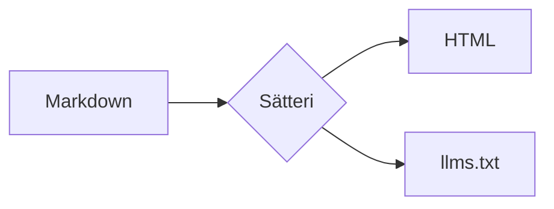

Pages are written in Markdown or MDX. ZenithDocs supports GitHub Flavored Markdown out of the box: tables, task lists, strikethrough, autolinks and footnotes.

## Text formatting

You can use **bold**, _italic_, ~~strikethrough~~, `inline code` and [links](/installation/). Keyboard keys use the HTML element: press <kbd>Ctrl</kbd> + <kbd>K</kbd>.

> Blockquotes are useful to quote other sources.

- Unordered lists
  - can be nested
- [x] and turned into task lists
- [ ] like this one

1. Ordered lists
2. work too

## Callouts

Use a container directive to highlight important information. The label between brackets replaces the default title.

:::note
Notes add context the reader should know about.
:::

:::tip[Pro tip]
Tips help readers get more out of a feature.
:::

:::important
Important callouts hold information the reader must not miss.
:::

:::success
Success callouts confirm that something worked.
:::

:::warning
Warnings point out things that could go wrong.
:::

:::danger
Danger callouts flag destructive or irreversible actions.
:::

[GitHub alerts](https://docs.github.com/en/get-started/writing-on-github/getting-started-with-writing-and-formatting-on-github/basic-writing-and-formatting-syntax#alerts), the blockquote syntax GitHub uses for callouts, work too. Files render the same on GitHub and on your site:

> [!WARNING]
> This callout was written with the GitHub alert syntax.

The six types are `note`, `tip`, `important`, `success`, `warning` and `danger`. Aliases keep their own title: `info` is a note, `idea` a tip, `check` a success, `warn` a warning, and `caution` and `error` are dangers.

## Headings

Headings from level 2 to 3 are listed in the table of contents, and each one gets an anchor link. Set a custom id by ending the heading with `[#your-id]`.

### A heading with a custom id [#custom-id]

This heading can be linked to with [`#custom-id`](#custom-id).

## Diagrams

Code blocks whose language is `mermaid` are drawn as SVG when the site is built, with the colors of the site, so they follow dark mode. No diagram library is sent to the browser.

````md

````


Flowcharts, sequence, state, class and ER diagrams, and XY charts are supported. Other diagram types are shown as code, with a warning in the build output. Set `mermaid.fallback` to `'error'` to fail the build instead.

### Spacing and title

A keyword after `mermaid` sets the room between the nodes: `compact`, `normal` or `wide`. `title` adds a caption below the diagram.

````md

````


### Colors and default spacing

The `mermaid` option changes the defaults for every diagram, and the colors the diagrams are drawn with.

```js title="astro.config.mjs"
zenith({
  mermaid: {
    spacing: 'wide',
    colors: { line: 'var(--text-2)', surface: 'var(--background)' },
  },
});
```

## Math

Turn on `math` to write TeX between `$` for inline math and `$$` for blocks:

```js title="astro.config.mjs"
zenith({
  math: true, // [!code highlight]
});
```

```md
The identity $e^{i\pi} + 1 = 0$ links five constants.

$$
\int_0^1 x^2 \, dx = \frac{1}{3}
$$
```

The identity $e^{i\pi} + 1 = 0$ links five constants.

$$
\int_0^1 x^2 \, dx = \frac{1}{3}
$$

Math is rendered with KaTeX to MathML, which browsers lay out natively: it costs no stylesheet, font or script. It is off by default because it gives dollar signs a meaning, so prices in existing content would become math.

## Footnotes

Footnotes are collected at the end of the page.[^1]

[^1]: Like this one.
